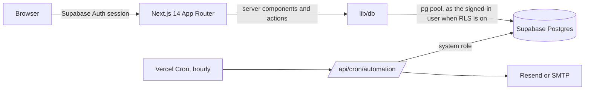

<div align="center">

# 🎯 PMS Pro

**Performance, goals and probation in one place, for employees, managers and HR.**

[](https://github.com/Nushra-khan/PMS_project/actions/workflows/ci.yml)


[Features](#-features) · [Quick start](#-quick-start) · [Configuration](#-configuration) · [Security](#-security) · [Testing](#-testing) · [Roadmap](#-roadmap)

</div>

---

## ✨ Features

| | Feature | What it does |
|---|---|---|
| 🧭 | **Role-aware dashboards** | Employees, managers and Admin (HR) each get their own view of goals, reviews, probation and notifications. |
| 🎯 | **Goals with roll-up** | Draft, submit, approve, update and archive goals. Company → team → individual goals roll their weighted progress upward. |
| ⏱️ | **Approval escalations** | Goals pending approval escalate to Admin after the configured number of business days. |
| 🌱 | **Probation tracking** | Day 30 / 60 / 80 checkpoints with paired employee and manager feedback. Deadlines skip weekends and recorded leave. |
| 📝 | **Review cycles** | Bi-annual and quarterly cycles are scheduled, opened and enrolled automatically, with reminders on the 5th, 15th and 22nd day and Admin escalation. Self reviews, manager reviews, discussions and final ratings. |
| 👥 | **People admin** | Admin grants roles, sets managers, teams and review tracks, and deactivates leavers. |
| 📈 | **Trends** | Six-month charts of feedback scores and flags, plus a My performance / My team switch for managers. |
| 🚩 | **Feedback flags** | Low scores, blank answers and negative language raise flags automatically. Flags with no Admin action in 7 days escalate to the secondary Admin. |
| 📊 | **Reports and CSV export** | Goals, reviews, probation, flags and audit data, scoped to what each role may see. Exports are safe from spreadsheet formula injection. |
| 🔔 | **Notifications** | In-app notices plus email through Resend or any SMTP server, delivered by an hourly worker. |
| 🧾 | **Audit trail** | Every workflow action is logged with who did it and when. |

## 🏗️ How it fits together



- **Pages and server actions** call `lib/db/*`, which talks to Postgres directly through `pg`.
- **Automation** (probation reminders, review cycles and reminders, goal and flag escalations, email delivery) runs from `/api/cron/automation`, which `vercel.json` schedules every hour.
- **Errors are visible.** If the database is configured but unreachable, the app shows an error page instead of empty screens.

## 🚀 Quick start

> Prerequisites: Node.js 22 and a Supabase project (or any Postgres for local testing).

```bash
# 1. Install
npm install

# 2. Configure (never commit real secrets; .env and .env.local are git-ignored)
cp .env.example .env.local

# 3. Create the schema and load sample data
psql "$DATABASE_URL" -f supabase/migrations/202604160001_initial_pms.sql
psql "$DATABASE_URL" -f supabase/seed.sql

# 4. Run
npm run dev
```

Open <http://localhost:3000> and sign in or create an account.

> 💡 Use Supabase's **Session pooler** connection string for `DATABASE_URL` if your network has no IPv6.

### 👤 Roles

New sign-ups always start as **employee**. The sign-up form does not offer a role choice. An Admin grants `manager` or `admin` in the `user_roles` table (or through Supabase `app_metadata.role`, which users cannot edit).

## ⚙️ Configuration

| Variable | Required | Purpose |
|---|---|---|
| `NEXT_PUBLIC_SUPABASE_URL` | ✅ | Supabase project URL |
| `NEXT_PUBLIC_SUPABASE_PUBLISHABLE_KEY` | ✅ | Supabase publishable (anon) key |
| `DATABASE_URL` | ✅ | Postgres connection string used by the server and `db:*` scripts |
| `APP_URL` | ✅ | Public URL of the app |
| `CRON_SECRET` | ✅ | Bearer token the scheduler sends to `/api/cron/automation` |
| `DB_ENFORCE_RLS` | | `true` runs user requests under row-level security ([see Security](#-security)) |
| `RESEND_API_KEY`, `EMAIL_FROM` | | Send email through Resend |
| `SMTP_HOST`, `SMTP_PORT`, `SMTP_USER`, `SMTP_PASS`, `SMTP_SECURE`, `SMTP_FROM_EMAIL`, `SMTP_FROM_NAME` | | Send email through SMTP when Resend is not set |
| `EMAIL_BATCH_SIZE` | | Emails sent per automation run (default 25) |

With no email provider configured, emails stay queued instead of failing silently.

## 🔐 Security

- **Secrets stay out of git.** `.env` files are ignored, and `.env.example` documents every variable.
- **Roles can't be self-assigned.** They come only from the database or `app_metadata`. If the database can't confirm a role, the user gets employee access.
- **Row-level security, ready to switch on.** `DATABASE_URL` connects as the database owner, which skips Postgres RLS. With `DB_ENFORCE_RLS=true`, every page read and user action runs as Supabase's `authenticated` role with the signed-in user's id, so the database enforces the same rules as the app. Automation, notifications and auto-raised flags still run as system on purpose.
- **Constant-time** cron secret check, and **CSV formula injection** protection on exports.

To turn RLS on:

1. Apply every file in `supabase/migrations/` to a **staging** project.
2. Set `DB_ENFORCE_RLS=true` there and check each screen as an employee, a manager and an admin.
3. Repeat in production. Setting it back to `false` restores the old behaviour without a deploy.

## 🧪 Testing

```bash
npm run typecheck   # TypeScript
npm run lint        # ESLint
npm test            # unit tests: CSV, working days, roll-up, review schedule, sentiment
```

Database tests run against a disposable Postgres. Each page read and each user action is run with RLS off and then on, and both runs must return the same result. The tests also check that the database refuses self-promotion, edits to other people's goals and spoofed audit entries.

```bash
scripts/sql/setup-test-db.sh "postgres://postgres@localhost:5432/pms_test"
TEST_DATABASE_URL="postgres://postgres@localhost:5432/pms_test" npm run test:db
```

GitHub Actions runs all of these on every pull request.

## 🗂️ Project structure

```text
app/
  (public)/login        sign in, sign up, forgot password
  (public)/reset-password  choose a new password from an email link
  auth/callback         exchanges email link codes for a session
  (app)/dashboard       role-aware home
  (app)/goals           goals, approvals, new goal form
  (app)/probation       probation checkpoints and decisions
  (app)/reviews         review cycles and submissions
  (app)/flags           feedback flags
  (app)/reports         reports and CSV exports
  (app)/admin           people, settings, cycles, probation admin
  api/cron/automation   hourly automation worker
components/             app shell and UI building blocks
lib/
  auth/                 session and role resolution
  db/                   Postgres queries, workflows, RLS helpers
  dates/                leave-aware working-day math
  goals/                goal roll-up
  reviews/              review cycle calendar and reminder rules
  feedback/             negative-sentiment check
  email/                Resend and SMTP delivery
supabase/
  migrations/           schema, RLS policies
  seed.sql              sample data
scripts/                seed, verify and test-database helpers
tests/                  unit tests and database tests
```

## 🛣️ Roadmap

- [x] Live data for every screen
- [x] Goal approvals with business-day escalation
- [x] Leave-aware probation deadlines
- [x] Flag auto-escalation after 7 days
- [x] Company → team → individual goal roll-up
- [x] Row-level security mode with tests
- [x] Admin people screen (roles, managers, teams, active status)
- [x] Automatic review cycles with 5th / 15th / 22nd reminders and Admin escalation
- [x] Negative-sentiment flags on open-ended feedback
- [x] My performance / My team dashboard toggle and six-month trend charts
- [x] Forgot password and reset password
- [ ] Weekly Admin digest
- [ ] Admin offboarding and successor hand-over
- [ ] Screenshots in this README

## 📜 Scripts

| Command | What it does |
|---|---|
| `npm run dev` | Start the dev server |
| `npm run build` / `npm start` | Production build and serve |
| `npm run db:push-seed` | Apply schema and seed using `.env` |
| `npm run db:seed-only` | Load sample data into an existing schema |
| `npm run db:verify-data` | Check the expected data shape |
| `npm run e2e:smoke` | Smoke test a running app |
